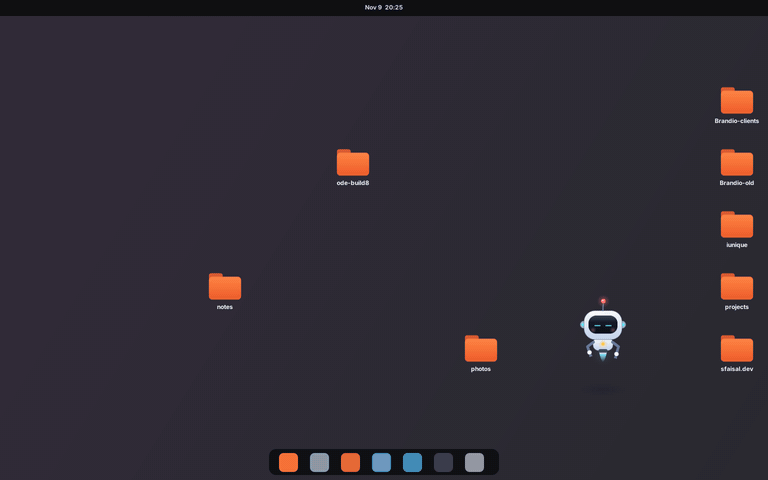
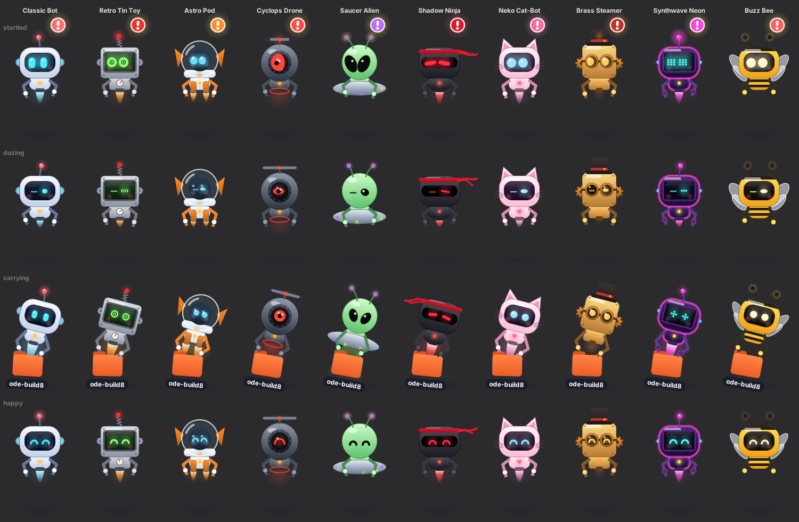

# TidyBot

**A little robot that lives on your Ubuntu desktop and keeps your icons tidy.**

It naps in a corner. When an icon ends up out of place, it wakes with a start, flies over, picks the icon up and slots it into a neat column on the right side of the screen. Then it goes back to sleep.




## Features

- **Tidies by itself.** Drop an icon anywhere and about a second later the robot fetches it and slots it into the first free spot in the right-hand column. Icons that are already lined up stay where they are.
- **Reacts to you.** If you move an icon while the robot is flying to it, the robot re-aims. If you drop another icon on the spot it's heading for, it picks the next free one.
- **Moves only icons, never files.** Files stay in your Desktop folder; only where their icons sit changes.
- **Also arranges Home,** and anything that's open or in use.
- **Has a personality.** It peeks with one eye when something moves, wakes with a "!", talks in speech bubbles, celebrates, and yawns before going back to sleep.
- **Can be dragged and thrown.** It swings from your cursor like a pendulum. Throw it and it tumbles, bounces off the screen edges and gets dizzy.
- **Comes in 10 skins,** chosen from its right-click menu.
- **Stays out of the way.** It lives on the desktop layer, so app windows cover it. Clicks anywhere except on the robot go to your desktop as usual.
- **Is light.** While napping it uses about 2–3% of one CPU core.

## Skins



| Skin | Look |
|---|---|
| **Classic Bot** | White robot with a cyan visor and a jet |
| **Retro Tin Toy** | 1950s box robot with dial eyes, a coil antenna and rivets |
| **Astro Pod** | Astronaut in a glass helmet with twin rocket boosters |
| **Cyclops Drone** | One red eye and a propeller on top |
| **Saucer Alien** | Green alien riding a flying saucer, with a tractor beam |
| **Shadow Ninja** | Black robot with a red eye slit and a flowing headband |
| **Neko Cat-Bot** | Pink cat ears, whiskers and a heart light |
| **Brass Steamer** | Top hat, goggles, turning gears and steam puffs |
| **Synthwave Neon** | Glowing neon outline and pixel eyes |
| **Buzz Bee** | Stripes, antennae and flapping wings |

## Requirements

- **Ubuntu 22.04 or newer** with the standard GNOME desktop and its built-in desktop icons (the *Desktop Icons NG* extension, `ding@rastersoft.com`, which Ubuntu ships enabled).
- **Python 3 with GTK 3.** This is already installed on Ubuntu. The installer adds it if it's missing.
- **Wayland or Xorg.** On Wayland it runs through XWayland automatically.

## Install

```bash
git clone https://github.com/sfaisaldev/tidybot.git
cd tidybot
bash install.sh              # add --autostart to start it when you log in
tidybot
```

Then drag a desktop icon into the middle of the screen and watch.

If the `tidybot` command isn't found, log out and back in, so `~/.local/bin` is on your PATH. You can also run it directly with `python3 ~/.local/share/tidybot/tidybot.py`.

## Using it

| Do this | What happens |
|---|---|
| **Click** the robot | It reacts ("Hehe!", or "Five more minutes..." if it was asleep) |
| **Right-click** the robot | Menu: Skin, Size, Tidy up now, Take a nap / Wake up, Quit |
| **Drag** the robot | It swings behind your cursor |
| **Let go gently** | That spot becomes its new napping place |
| **Throw** the robot | It tumbles, bounces off the edges, and gets dizzy |

The skin and size you choose are saved.

### Commands

| Command | What it does |
|---|---|
| `tidybot` | Start the robot |
| `tidybot --stop` | Quit (puts back anything it was carrying) |
| `tidybot --pause` | Deep sleep: it won't tidy until you run this again |
| `tidybot --scale 1.4` | Make the robot bigger |
| `tidybot --demo` | Add 4 sample text files at random spots, safe to delete |
| `tidybot --dry-run` | Animate only, without touching anything |
| `tidybot --debug` | Show the grid and icon positions it detects |
| `tidybot --perf` | Print frame timing every 5 seconds |

### Settings

The settings file is `~/.config/tidybot/settings.json`. It's created on first run.

| Setting | Meaning |
|---|---|
| `"side": "left"` | Line icons up on the left side instead of the right |
| `"ignore": ["name"]` | Icons the robot never touches |
| `"settle_seconds"` | How long icons must stay still before it wakes up (default 0.6) |
| `"skin"`, `"scale"` | Set from the right-click menu |
| `"coord_scale"` | Change this only if the robot aims at the wrong spots on a scaled display |

## How it works

Ubuntu's desktop-icons extension saves each icon's position as file metadata (`metadata::nautilus-icon-position`). Other apps can't drag those icons directly, so when the robot grabs one, TidyBot:

1. writes the new position into the file's metadata
2. renames the file to a hidden name for about 2 seconds, so the real icon disappears as the robot lifts its copy
3. renames it back when the robot drops it, so the desktop shows the real icon in its new spot

The file's contents and folder never change. Programs using the file keep working, because Linux tracks open files by the file itself, not by its name.

The Home icon isn't a file on the Desktop, so it's moved by switching the desktop's "show Home icon" setting off and on.

The robot itself is drawn with Cairo in a transparent window on the desktop layer. Only the area around the robot catches clicks.

## Performance

These numbers were measured on the real app with `--perf`.

| State | Frame rate | CPU |
|---|---|---|
| Napping (most of the time) | 20 fps | about 2–3% of one core |
| Working (a few seconds per tidy) | steady 60 fps | about 11% of one core |

Memory stays between 50 and 100 MB, with no growth over a 30-minute soak test. Only the small area around the robot is redrawn.

## Safety

- If TidyBot is stopped while carrying an icon, the file is put back on exit. If it crashed, the file is put back on the next start.
- It never overwrites a file. If a program creates a file with the same name during the 2-second carry, the robot puts its copy back as `name (2)`.
- It refuses to be dragged while carrying an icon, so a file can't get stuck hidden.
- If the desktop doesn't keep the positions it sets, it stops after 2 tries instead of looping.

## Troubleshooting

**Right-click opens Ubuntu's desktop menu instead of TidyBot's.** Right-click directly on the robot's body. If it still happens, quit and restart TidyBot so it can place itself above the desktop icons again.

**The robot aims at the wrong spot.** Run `tidybot --debug` and check the grid it reports. On scaled displays, try `"coord_scale"` in the settings file.

**It feels laggy.** Run `tidybot --perf` and look at the `max` frame gap while it moves.

**It never wakes up.** It stays asleep if *Keep Arranged* is turned on in the desktop's right-click menu, because Ubuntu is already arranging the icons. Also check that you didn't pause it.

**A file disappeared from the desktop.** It's hidden mid-carry. Start or stop TidyBot once and it's restored. You can also look for `.tidybot-hold-*` names in `~/Desktop`.

## Known limits

- An editor such as VS Code with a desktop folder open may briefly notice that folder disappear and come back during the 2-second carry.
- The Trash icon can't be moved; the robot keeps its spot free.
- When the right column is full, extra icons continue at the top of the next column.
- The napping spot you pick by dragging isn't saved yet; after a restart, the robot naps in the bottom-right corner again.

## Uninstall

```bash
tidybot --stop
rm -rf ~/.local/share/tidybot ~/.local/bin/tidybot ~/.config/tidybot ~/.config/autostart/tidybot.desktop
```

## License

MIT. See [LICENSE](LICENSE).
